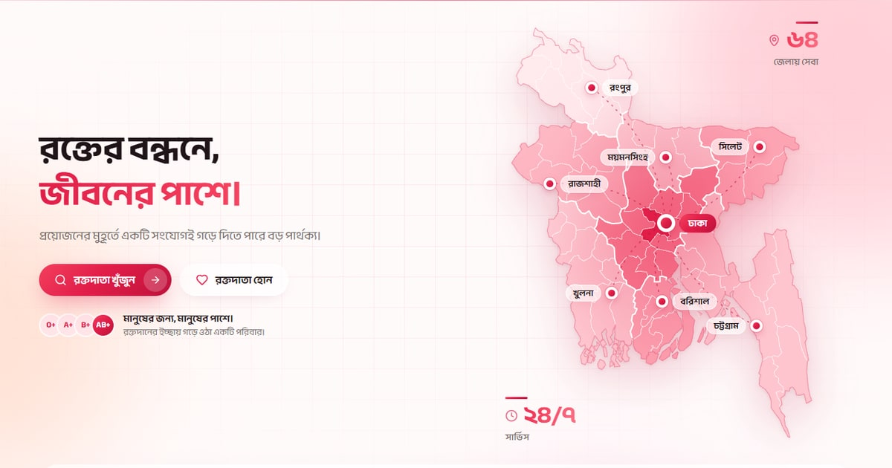
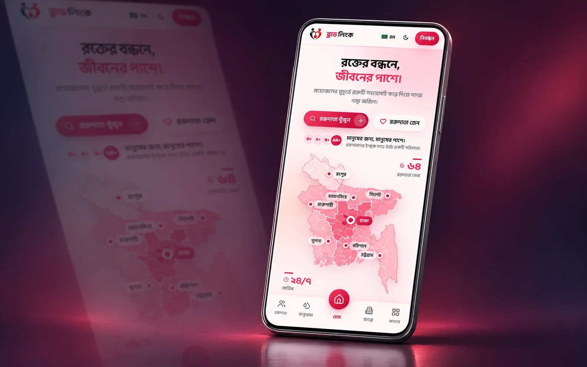
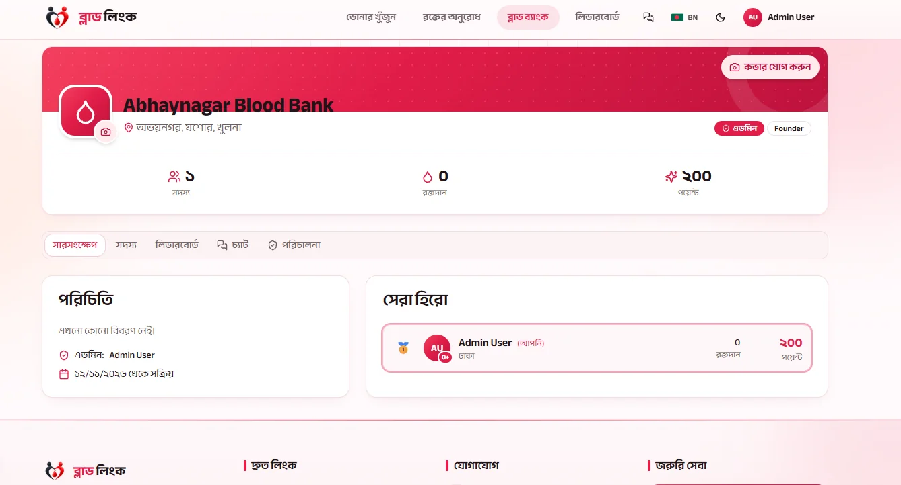
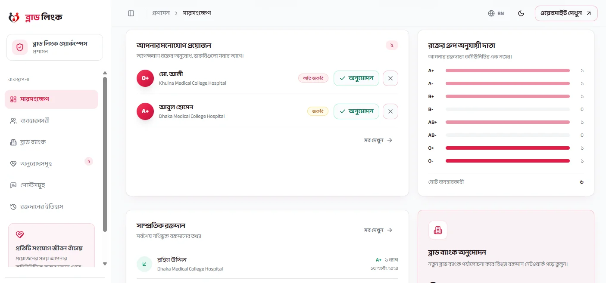

  
  
  <h1>Blood Link · ব্লাড লিংক</h1>
  
<strong>Connected by blood. United for life.</strong>

  
A community-focused frontend for finding blood donors and organizing local blood donation communities in Bangladesh.

  

    <a href="https://blood-linkbd.vercel.app">Live demo</a> ·
    <a href="#features">Features</a> ·
    <a href="#screenshots">Screenshots</a> ·
    <a href="#getting-started">Getting started</a> ·
    <a href="#contributing">Contributing</a>
  

  
<strong>Frontend</strong> 
    
    
    
    
    
    
  

  
<strong>Backend</strong> 
    
    
    
  

## Overview

Blood Link brings donor discovery, blood requests and local blood bank communities into one interface. Visitors can search by blood group and location, explore local groups and find the path to registration. Members have access to profiles, messaging and community participation features.

This repository contains the frontend application, with English and Bangla translations, light and dark themes, responsive navigation and reusable interface components.

## Features

| Experience | Highlights |
| --- | --- |
| **Find potential donors** | Blood group and location filters, a Bangladesh map and donor profile views. |
| **Share blood requests** | Request listings, signed-in posting and an urgent request interface. |
| **Build local communities** | Blood bank discovery, group profiles, membership views and management panels. |
| **Recognize participation** | Donation leaderboards, points and badges, with location and time-period filters. |
| **Manage a donor profile** | Registration, profile editing, donation history and public visibility controls. |
| **Stay in touch** | Conversation lists, direct messages and community chat interfaces. |
| **Review activity** | An admin workspace for requests, members and community management. |
| **Choose your experience** | English/Bangla language switching, light/dark themes and mobile bottom navigation. |

## Screenshots

### Mobile experience

The mobile layout keeps donor discovery, registration and community navigation close at hand.

### Community and management views

<table>
  <tr>
    <td width="50%"></td>
    <td width="50%"></td>
  </tr>
  <tr>
    <td align="center"><strong>A home for local communities</strong></td>
    <td align="center"><strong>A focused review workspace</strong></td>
  </tr>
</table>

## Frontend stack

| Technology | Purpose |
| --- | --- |
| Next.js App Router | Application routes, layouts and metadata. |
| React + TypeScript | Interactive screens and typed components. |
| Tailwind CSS + shadcn/ui | Responsive styling and reusable interface components. |
| TanStack Query | Client-side data state, loading states and caching. |
| React Hook Form + Zod | Form handling and input validation. |
| i18next + react-i18next | English and Bangla translations. |
| next-themes | Light and dark appearance preferences. |
| Recharts + Lucide React | Charts and interface icons. |
| Vitest + Testing Library | Frontend tests and component checks. |

## Backend stack

| Technology | Purpose |
| --- | --- |
| Golang | Backend application language. |
| Gorilla Mux | Request routing. |
| PostgreSQL | Relational data storage. |

## Getting started

### Requirements

- Node.js **20.9 or newer**.
- pnpm **12.18.0**, as declared in <code>package.json</code>.

### Run the frontend

~~~bash
git clone https://github.com/arcbit-technology/blood-link-ui.git
cd blood-link-ui
pnpm install
pnpm dev
~~~

Open [localhost:3000](http://localhost:3000) in your browser.

These commands start the frontend development workspace. Account-based and live-data workflows require a maintainer-prepared development environment; the live demo is available for exploring the deployed experience.

### Available commands

| Command | Description |
| --- | --- |
| <code>pnpm dev</code> | Start the frontend development server. |
| <code>pnpm build</code> | Create a production build. |
| <code>pnpm start</code> | Serve an existing production build. |
| <code>pnpm typecheck</code> | Generate route types and check TypeScript. |
| <code>pnpm lint</code> | Run ESLint. |
| <code>pnpm test</code> | Run the frontend test suite once. |
| <code>pnpm test:watch</code> | Run tests in watch mode. |

To preview a production build locally:

~~~bash
pnpm build
pnpm start
~~~

## Explore the interface

| Page | Frontend route |
| --- | --- |
| Homepage | <code>/</code> |
| Donor discovery | <code>/donors</code> |
| Blood request listings | <code>/posts</code> |
| Local blood bank directory | <code>/blood-banks</code> |
| Create a community group | <code>/blood-banks/new</code> |
| Community profile | <code>/blood-banks/[id]</code> |
| Donation leaderboard | <code>/leaderboard</code> |
| Sign in and registration | <code>/login</code>, <code>/register</code> |
| Donor profile | <code>/profile</code> |
| Conversations | <code>/messages</code> |
| Urgent request form | <code>/emergency-request</code> |
| Admin workspace | <code>/admin</code> |

Account pages and workspace actions are available according to the signed-in user's role.

## Project structure

~~~text
src/
├── app/          # App Router pages, layouts and providers
├── views/        # Route-level interactive screens
├── components/   # Home, donor, community, chat and shared UI
├── contexts/     # Shared client-side state
├── hooks/        # Reusable frontend hooks
├── locales/      # English and Bangla translation files
├── lib/          # Shared frontend utilities
├── types/        # TypeScript definitions
└── test/         # Frontend tests and setup
public/           # Logos, icons and static assets
docs/
└── images/       # README screenshots and mobile mockup
~~~

## Contributing

Contributions to the frontend are welcome, especially accessibility improvements, clearer donor search, translation fixes, mobile usability, component tests and documentation.

1. Open an issue to describe a bug or discuss a larger change.
2. Fork the repository and create a focused branch.
3. Follow the existing component patterns and update both language files when changing visible copy.
4. Run <code>pnpm typecheck</code>, <code>pnpm lint</code>, <code>pnpm test</code> and <code>pnpm build</code> before submitting your change.
5. Open a pull request with a clear description and screenshots for visual changes.

Use fictional or redacted donor information in examples, screenshots and bug reports. Keep credentials and private personal data out of commits and issue reports.

## License

A license has not yet been specified in this repository.

---

  <strong>People helping people, one connection at a time.</strong> 
  <a href="https://blood-linkbd.vercel.app">Explore Blood Link</a>

